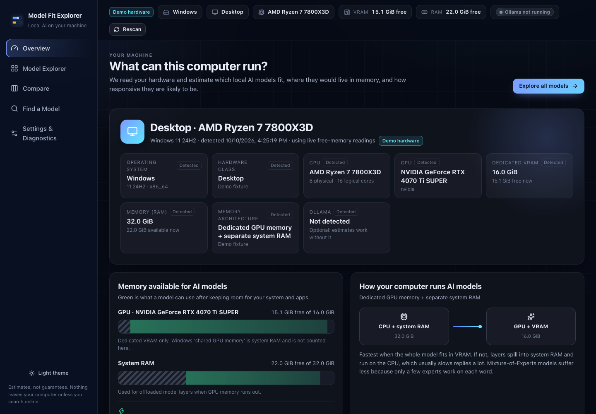
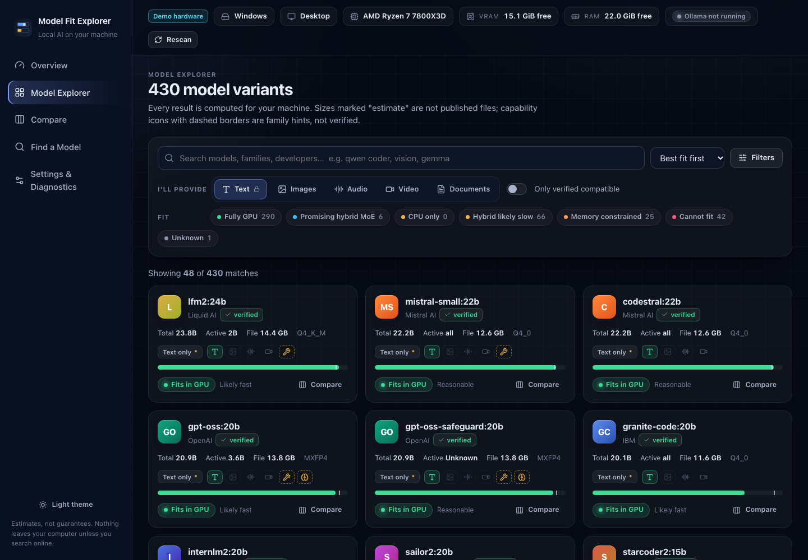
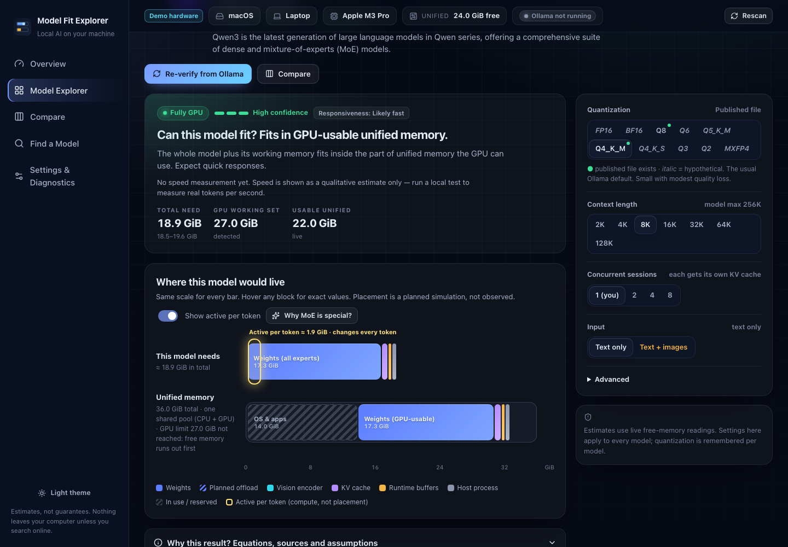

# Model Fit Explorer

**Which local AI models can your computer actually run?** A cross-platform desktop app that detects your hardware, estimates where each model would live in memory (GPU VRAM, system RAM or Apple unified memory), and tells you, honestly, whether it will be fast, slow or won't fit.

**[▶ Try the web demo](https://maninka123.github.io/local-llm-fit/)** (demo hardware; the desktop app reads your real machine)


## Features

- **Automatic hardware detection** on Windows, macOS and Linux: CPU, RAM, GPU, dedicated vs. shared memory, Apple unified memory and the Metal working-set limit, laptop/desktop signals. Every value shows its source and can be overridden.
- **430+ model variants** with exact file sizes, layers and KV heads from the official Ollama registry, starting from a seed catalog that is clearly marked as heuristic.
- **Memory visualization**: model weights, KV cache and buffers drawn on the same scale as your VRAM and RAM, with planned offload and an "active per token" overlay for Mixture-of-Experts models.
- **Honest classification**: *Fully GPU · Promising hybrid MoE · Hybrid likely slow · CPU only · Memory constrained · Cannot fit · Unknown*, with confidence and a "Why this result?" breakdown. No made-up tokens/sec.
- **Inputs and outputs per model**: pick what you'll provide (text is always on; add images, audio, video or documents), with verified support kept separate from family hints.
- **Live lookup** of any model on ollama.com or Hugging Face, with a confirmation sheet before anything is saved. Works offline with cached data and manual entry.
- **Optional local benchmark** through Ollama (only when you click *Run Test*), comparing predicted and measured memory, TTFT and tok/s.
- Quantization, context, concurrency and image controls; Compare up to 4 models; CSV/JSON import and export; dark and light themes; keyboard and reduced-motion support.

| Overview | Explorer | Apple Silicon (unified memory) |
| --- | --- | --- |
|  |  |  |

## Get the app

Download installers from [Releases](https://github.com/maninka123/local-llm-fit/releases) (`.dmg` for macOS, `.msi`/`.exe` for Windows, `.AppImage`/`.deb` for Linux). Builds are unsigned: on macOS right-click → **Open** the first time; on Windows choose **More info → Run anyway**.

Ollama is optional. Estimates work without it; install [Ollama](https://ollama.com) to see installed models and run benchmarks.

## Build from source

Requirements: Node.js 22+, Rust (stable), and the [Tauri 2 prerequisites](https://v2.tauri.app/start/prerequisites/) for your OS (Xcode Command Line Tools on macOS, WebView2 + MSVC Build Tools on Windows, `libwebkit2gtk-4.1-dev libgtk-3-dev librsvg2-dev` on Linux).

```bash
npm install
npm run app:dev      # desktop app with live reload
npm run app:build    # installers in src-tauri/target/release/bundle/
npm run dev          # browser preview with demo hardware (http://localhost:5173)
```

| Platform | Output (`src-tauri/target/release/bundle/`) | Notes |
| --- | --- | --- |
| macOS | `macos/*.app`, `dmg/*.dmg` | Add `--target universal-apple-darwin` for Intel + Apple Silicon |
| Windows | `msi/*.msi`, `nsis/*-setup.exe` | Build on Windows |
| Linux | `appimage/*.AppImage`, `deb/*.deb`, `rpm/*.rpm` | Build on Linux (Ubuntu 22.04+) |

Each OS builds its own installers. Pushing a tag like `v1.0.0` runs `.github/workflows/release.yml`, which builds all three and attaches them to a draft release.

## How the estimate works

`total = weights (all experts) + KV cache + compute buffers + image activations + backend context + host process`, compared with **live free** VRAM/RAM minus a reserve (or 10% / 20% reserves in planning mode). Unified memory is treated as one pool, shared GPU memory is never counted as VRAM, and multiple GPUs are not added together unless you enable it. Full details: [docs/ESTIMATION.md](docs/ESTIMATION.md).

## Development

```bash
npm test              # 65 unit tests (estimator, capabilities, catalog, parsers)
npm run test:e2e      # Playwright E2E + screenshot tests
npm run test:rust     # Rust probe fixtures for Windows/Linux/macOS + backend allowlists
npm run probe         # print this machine's hardware report as JSON
npm run catalog:refresh   # re-verify the catalog against ollama.com (metadata only)
```

## Privacy

No telemetry or accounts. Hardware details never leave your computer. Online lookups send only the model name you type (to ollama.com and huggingface.co). Benchmarks and downloads run only after you confirm.

## Author

**Pasindu Ranasinghe**

## License

[MIT](LICENSE)
