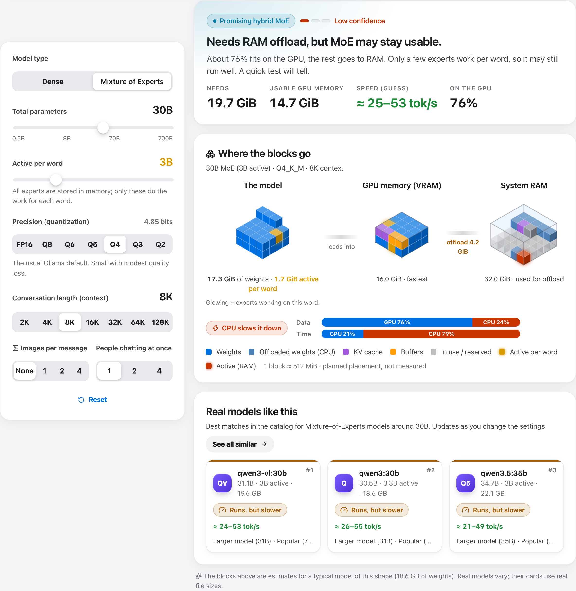
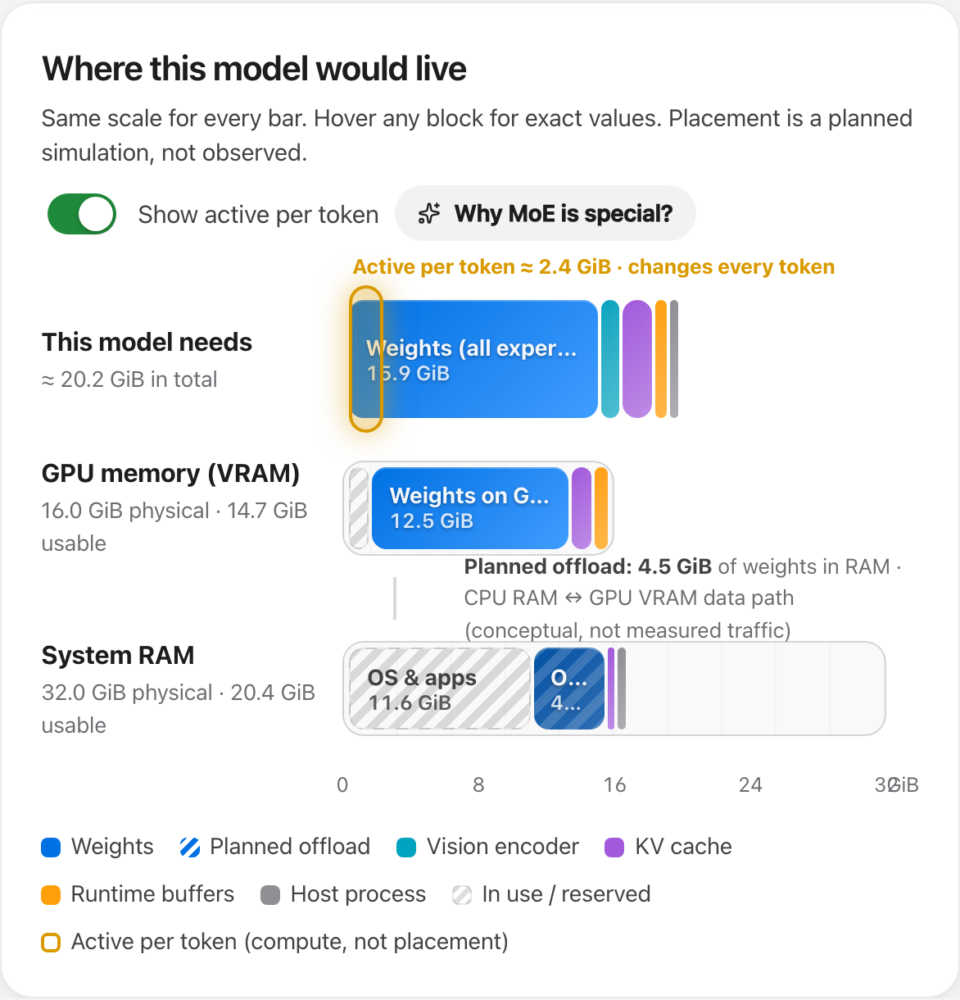
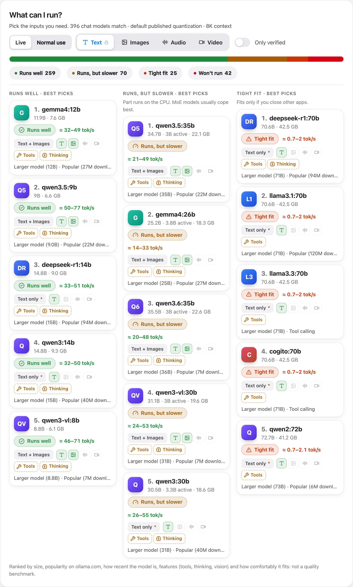

# Model Fit Explorer

**Which local AI models can your computer actually run?** Build a model in the Playground and watch its memory blocks settle into your GPU memory and RAM, or let the app rank the best models for your machine. Works on Windows, macOS and Linux.

**[▶ Try it in your browser](https://maninka123.github.io/local-llm-fit/)** · **[Download the desktop app](https://github.com/maninka123/local-llm-fit/releases/latest)**

> **Tip:** Browsers hide exact hardware details, so the web version estimates your machine and may not get every spec right. For exact, live readings, use the desktop app. It's a tiny download (about 2–3 MB on Windows and Mac). The website has a **Get the desktop app** button that picks the right file for you.



## What it does

- **Playground.** Drag the model size, switch between dense and Mixture-of-Experts, pick precision, context, images and people chatting at once. The model is drawn as a cube of memory blocks (the active part glows) that fills your VRAM and RAM. Offload and "doesn't fit" are shown as they happen.
- **What can I run.** Every model in a 430+ variant catalog is sorted into *Runs well · Runs, but slower · Tight fit · Won't run* and ranked best-first using size, popularity, recency, features and fit (each card says why).
- **Try a specific model.** Search Ollama or Hugging Face, paste a link, or type the details. See compatibility instantly, then save it to your catalog.
- **Honest estimates.** Exact file sizes, layers and KV heads come from the official Ollama registry. Apple Silicon is treated as one unified pool, Windows "shared GPU memory" is never counted as VRAM, and speed is never invented. A local benchmark (through Ollama, only when you click) measures real tokens per second.
- **Sample machines** to explore without your own hardware: build a desktop or workstation (pick the graphics card, its memory size and 1 or 2 cards), a gaming laptop (pick the laptop GPU), a Mac (pick the model, then a chip it really ships with and that chip's memory sizes), an office laptop, or a single-board / edge AI device (Raspberry Pi 4/5, Orange Pi 5 Plus, Jetson Nano, Orin Nano Super, Orin NX, AGX Orin, AGX Thor, DGX Spark).
- **Light, dark or system theme**, keyboard and reduced-motion friendly.





## Desktop app vs. browser

| | Desktop app | Browser |
| --- | --- | --- |
| Hardware detection | Exact and live (GPU, VRAM, free memory, Apple working-set limit) | GPU name and CPU threads from the browser, known GPU specs, plus a 30-second confirmation |
| Model search | Ollama + Hugging Face | Hugging Face (ollama.com blocks browser requests); bundled verified catalog |
| Local Ollama, benchmarks | Yes | Only if you allow the site in `OLLAMA_ORIGINS` |
| Updates | Automatic, signed | Always the latest |

## Install

Download from [Releases](https://github.com/maninka123/local-llm-fit/releases/latest). Not sure which file? See **[which file to download](docs/RELEASE_ASSETS.md)**. In short: Windows `…x64-setup.exe`, Mac `…aarch64.dmg` (Apple Silicon) or `…x64.dmg` (Intel), Linux `…amd64.AppImage`, Raspberry Pi / Jetson / other 64-bit ARM boards `…aarch64.AppImage`. The installers are not code-signed yet: on macOS right-click the app → **Open** the first time; on Windows choose **More info → Run anyway**.

The app checks GitHub for new versions on launch and shows an update dialog with progress; it can also be checked from **Settings → Updates**. On Linux, auto-update applies to the AppImage; `.deb`/`.rpm` installs update through your package manager.

[Ollama](https://ollama.com) is optional: estimates work without it.

## Build from source

Requirements: Node.js 22+, Rust (stable) and the [Tauri 2 prerequisites](https://v2.tauri.app/start/prerequisites/) for your OS.

```bash
npm install
npm run dev          # browser version at http://localhost:5173
npm run app:dev      # desktop app with live reload
npm run app:build    # installers in src-tauri/target/release/bundle/
```

Each OS builds its own installers (macOS: `.app`/`.dmg`, Windows: `.msi`/`.exe`, Linux: `.AppImage`/`.deb`/`.rpm`).

## Releasing a new version

```bash
npm version 1.1.0      # updates the version and creates the tag v1.1.0
git push --follow-tags
```

The tag starts `.github/workflows/release.yml`, which builds Windows, macOS (Apple Silicon + Intel) and Linux (x64 + ARM64), signs the update bundles with the `TAURI_SIGNING_PRIVATE_KEY` repository secret, publishes the release and its `latest.json`. Installed apps then offer the update automatically. The private key must stay secret and backed up: without it, existing installs can't verify new updates.

## How the estimate works

`total = weights (all experts) + KV cache + compute buffers + image activations + backend context + host process`, compared with free memory minus a reserve. Details and rules: [docs/ESTIMATION.md](docs/ESTIMATION.md).

## Development

```bash
npm test              # unit tests (estimator, ranking, capabilities, catalog, browser detection)
npm run test:e2e      # Playwright end-to-end + screenshot tests
npm run test:rust     # hardware probe fixtures for Windows/Linux/macOS + backend allowlists
npm run probe         # print this machine's hardware report as JSON
npm run catalog:refresh   # re-verify the catalog against ollama.com (metadata only)
```

## Privacy

No telemetry or accounts. Hardware details never leave your computer. Online lookups send only the model name you type. Benchmarks and downloads run only after you confirm.

## License

[MIT](LICENSE)
